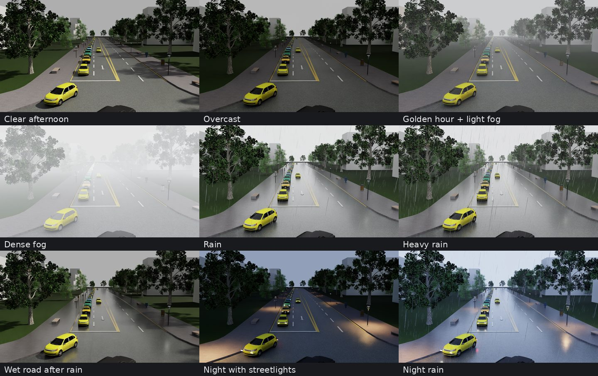
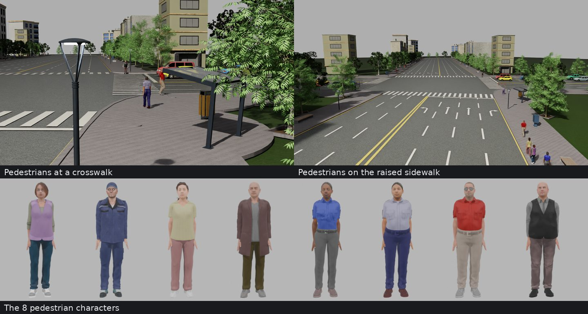
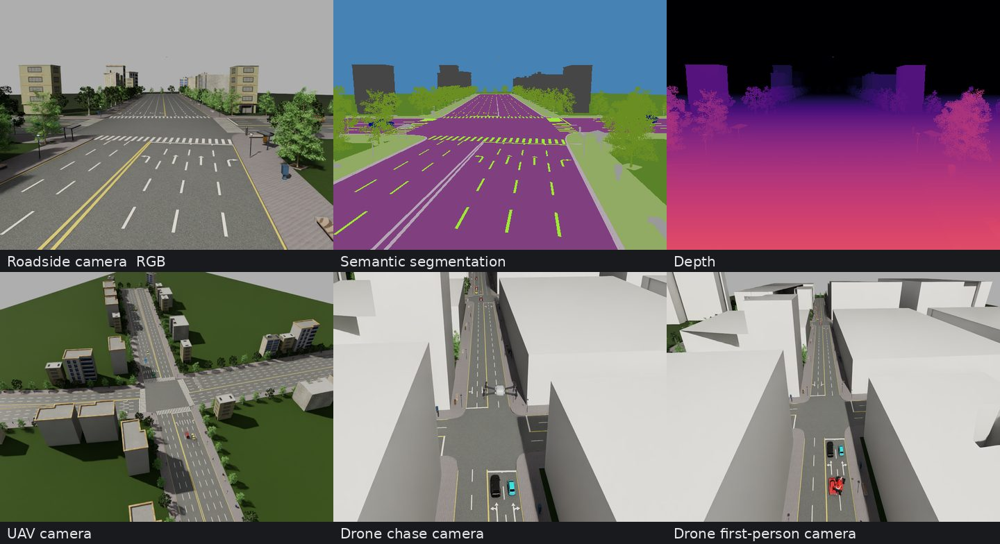
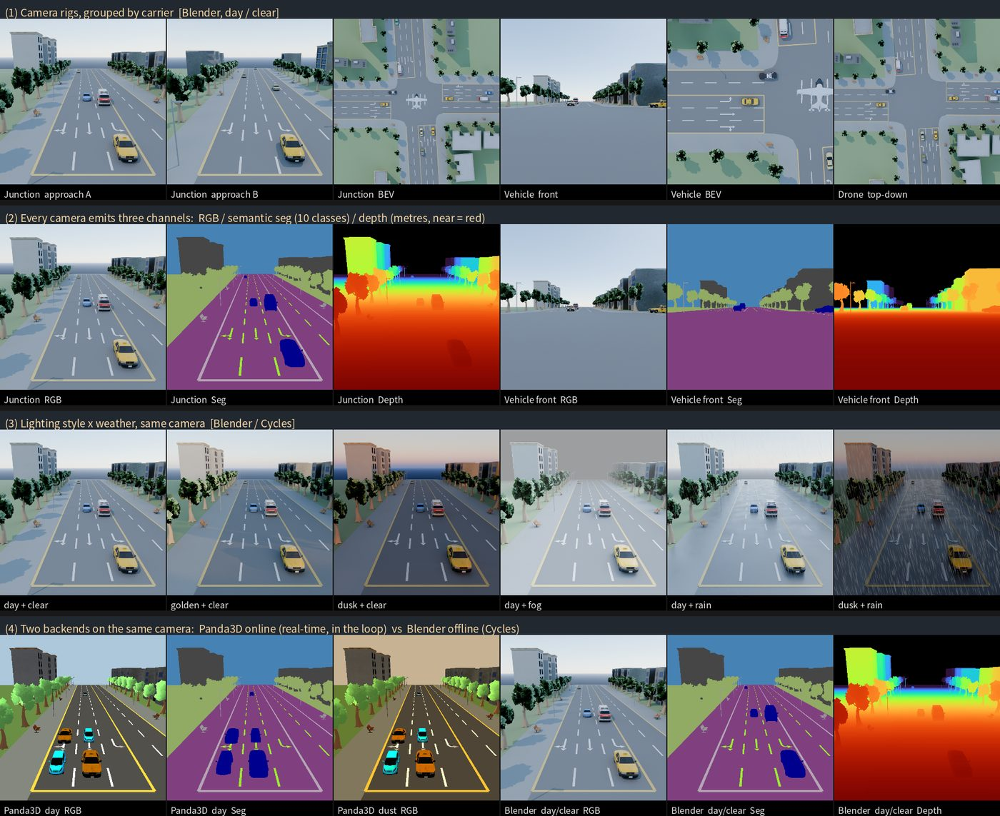
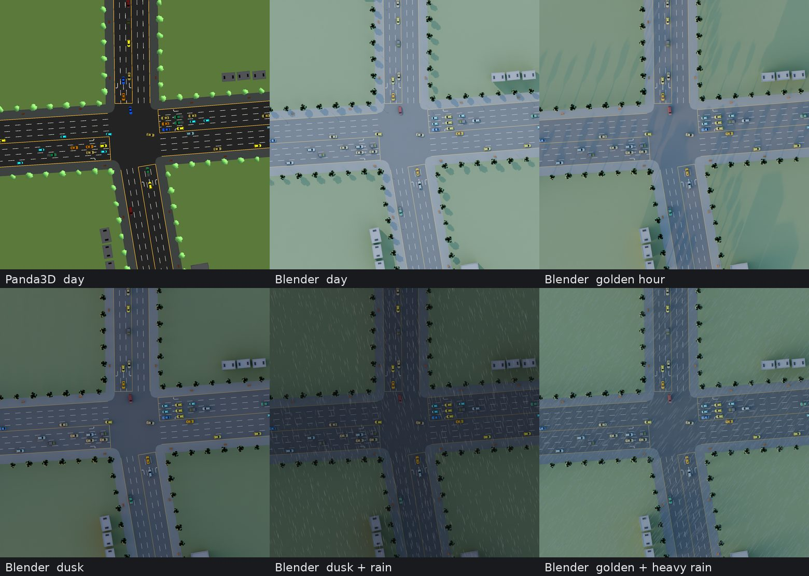
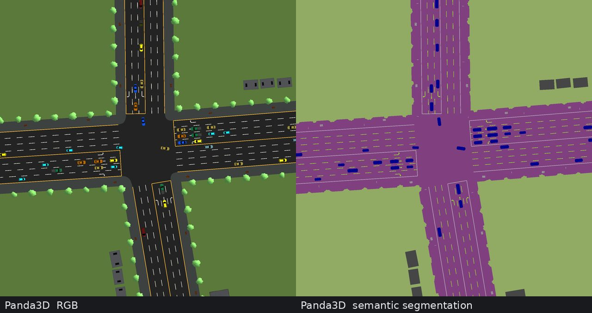
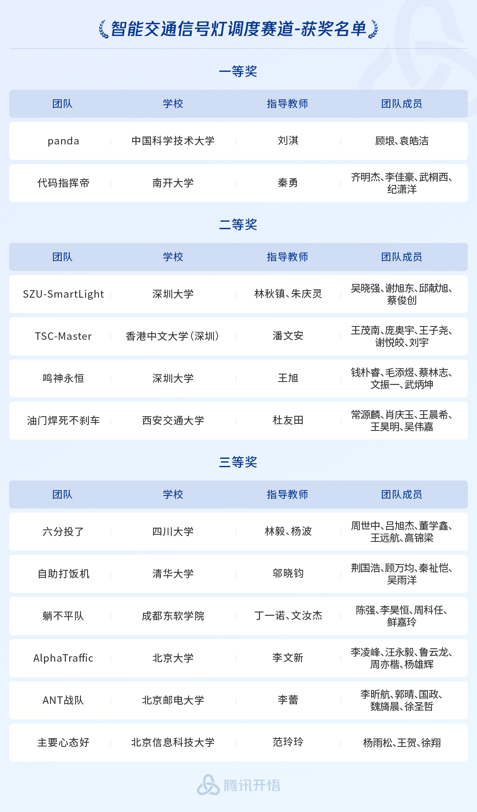

<!--
 * @Author: WANG Maonan
 * @Date: 2023-08-23 17:15:09
 * @Description: All notable changes to this project.
 * @LastEditTime: 2026-11-24 14:43:28
-->
# Change Log

All notable changes to this project will be documented in this file. 
All text added must be human-readable. 
Copy and pasting the git commit messages is **NOT** enough. 

## [Unreleased] - XXXX-XX-XX

Planned as v2.4: the TSHub3D scene library.

### Added

- 60 ready-to-use 3D scenes from cities around the world (33 single intersections and 27 multi-intersection networks), released as open source.


<!-- v2.3 -->
## [v2.3] - 2026-11-24

### News 🎓

I have attended my PhD graduation ceremony at CUHK-Shenzhen. Thank you to my supervisor, Prof. Simon Pun, to Yuheng Kan and Yirong Chen from my time at Shanghai AI Lab, and to everyone who supported me along the way.

顺利参加了香港中文大学（深圳）的博士毕业典礼。感谢导师 Simon Pun 教授，感谢在上海人工智能实验室期间指导我的 Yuheng Kan 和 Yirong Chen，也感谢一路以来支持和帮助我的每一个人。

**Acknowledgements 致谢**

- **Supervisor:** Prof. Simon Pun
- **Simon's group:**
  - PhD students: Aoyu Pang, Yuejiao Xie, Ziyao Wang, Hongyang Zhang, Ziyi Wang, Qianqian Wu
  - Undergraduate students: Zhiheng Li, Yu Liu, Yin Luo
- **Collaborators:**
  - Shanghai AI Lab: Yirong Chen
  - SenseTime: Yuheng Kan, Zian Ma, Chengcheng Xu
  - Nanyang Technological University (NTU): Yuxin Cai
  - Nokia Bell Labs: Chung Shue (Calvin) Chen, Laurent Roullet
  - Tongji University: Prof. Xi Xiong, Lu Liu, Yuting Wang
  - Beihang University: Prof. Zhiyong Cui, Kemou Jiang

### Changed

- The 3D package is reorganised so that each part has one job: shared definitions, rendering, scene building, episode recording and asset tools. Code that imports 3D internals must update its imports; the main entry points (`Tshub3DEnvironment`, `IsaacRenderer`, the episode reader and writer) are unchanged.
- Vehicles, event props, aircraft and pedestrians now share one 3D asset library, rebuilt by a single command. Episodes recorded with the old asset names must be recorded again.
- Every 3D asset has a preview image with five views around the model.
- The default ego vehicle is now an ordinary sedan, repainted like the other cars. The F1 car is kept as an easter egg.
- The eVTOL model is about 6× lighter, and its tail propellers now spin.
- The incident route generator (crashes, breakdowns, cones) now sits with the other SUMO route tools, so incidents also work in SUMO-only runs.

### Fixed

- The 3D box of a crashed car now covers only the car, not the debris around it.
- The driver of a broken-down car now stays by the car.


<!-- v2.2 -->
## [v2.2] - 2026-11-12

### Added

- Weather and time of day for Isaac rendering: cloud cover, fog, rain, wet roads, and streetlights that turn on at night.
- Fog is set by visibility distance and calibrated so that the camera sees the configured visibility.
- Rain falls smoothly from frame to frame and replays identically. Lidars see raindrops as unlabelled points.
- New weather presets: light fog, dense fog, light rain, rain and heavy rain.
- Weather and lighting can change every episode, either set explicitly or drawn at random. Each episode records the values it used.

<div align=center>
   
</div>
<p align="center">The same camera under nine weather and lighting settings.</p>


<!-- v2.1 -->
## [v2.1] - 2026-11-08

### Added

- Pedestrians in 3D: SUMO pedestrians are rendered as eight realistic characters. Their walking animation follows their speed, they stand still when stopped, and they walk on top of raised sidewalks.
- Vehicle wheels spin with the distance driven, and front wheels steer through turns (Ackermann geometry). Replayed episodes show the same wheel motion.
- One reader for all common SUMO output files (trip info, trajectories, summary, queues, detectors, traffic-light programs, routes, …), returning pandas tables, plus plotting helpers.

<div align=center>
   
</div>
<p align="center">Pedestrians at a crosswalk and on the raised sidewalk, and the eight pedestrian characters.</p>

### Changed

- Smoother turns at intersections: networks are built with more detailed junction paths, so turning vehicles no longer appear to slide sideways. Traffic results are practically unchanged (mean trip time within ±2%).
- Building a network from OpenStreetMap is now a single call that creates both the road network and the building polygons. Underground buildings are no longer placed on the road.
- The examples now use two scenarios: a single intersection with sidewalks and pedestrians, and an OSM network of Berlin.
- Generated 3D scenes keep trees and street furniture off sidewalks and crosswalks.

### Removed

- The OSM filtering tool. The filtered map changed the generated network, so scenes now use the original OSM file.
- The old SUMO output analysis scripts (replaced by the new readers), several old example scenarios, and the radio-map grid.


<!-- v2.0 -->
## [v2.0] - 2026-11-05 - A brand-new TransSimHub 🚀

🎉 A full refactor of TransSimHub: 3D rendering moves to Isaac Sim, and the package is reorganised around what is being simulated.


### Changed (breaking)

- New package layout, grouped by what is simulated: the traffic simulation, the road network, SUMO traffic (vehicles, traffic lights, pedestrians, roads), aircraft, the 3D package and the SUMO tools. The examples follow the same layout.
- `TshubEnvironment` follows the Gymnasium interface: `reset()` returns `(obs, info)` and `step()` returns `(obs, reward, terminated, truncated, info)`. Each module is turned on by passing its config.
- The static road network (topology, traffic lights, geometry, buildings) is read once and available as `env.network`, instead of being part of every observation.
- `info['ready']` lists the traffic lights, vehicles and aircraft that can act at the current step, so modules with different decision frequencies can be controlled together.
- One simulation clock, with all times in seconds, so behaviour no longer depends on the step length. For example, a yellow light now lasts 3 s instead of 3 steps.
- The random seed now takes effect; before, SUMO's default seed was often used instead.
- In the `next_or_not` traffic-light action, `1` now switches to the next phase and `0` keeps the current one. Agents trained with the old meaning must be retrained.
- 3D rendering runs on Isaac Sim; Blender is only used to build static scenes. Rendering is faster because scene updates are batched and vehicle models are reused.

<div align=center>
   
</div>
<p align="center">Isaac Sim rendering: a roadside camera with RGB, semantic segmentation and depth, a UAV camera, and drone chase and first-person cameras.</p>

### Added

- Trajectory control for vehicles: a planner sends future waypoints, and the vehicle follows them with a bicycle-model tracker (or perfectly, for testing) while the surrounding traffic reacts. Controlled vehicles can be handed back to SUMO.
- New vehicle state: collisions, control mode, plan progress, and a reference path along the lanes ahead for planners.
- Realistic UAV flight: a multirotor model with wind and gusts, energy use, and commands for velocity, waypoints, timed trajectories and vision-language navigation (forward, turn, ascend, descend, stop). One environment step can run until a command finishes.
- V2X communication: vehicles, roadside units and UAVs exchange messages of any content. Delivery depends on distance, standard channel models, fading and message size, so large messages such as images arrive later. Signal timing (SPaT) and safety (BSM) messages are included.
- Traffic lights report their current signal and the time to the next switch.

### Changed

- Traffic-light, vehicle and aircraft actions share the same internal structure; public imports are unchanged.

### Removed

- All 2D visualization (the matplotlib renderer, the web dashboard and SUMO-GUI screenshots). SUMO-GUI itself is still available.
- The Panda3D renderer, the Blender episode renderer and the separate low/high-poly vehicle sets. Isaac Sim is now the only 3D renderer.
- The old standalone V2I/V2V channel classes, replaced by the V2X module.
- Unused utilities.

### Fixed

- Changing a phase duration had no effect.
- Lane-change direction was inconsistent between action types. Left is now `+1` everywhere.
- Traffic-light features assumed 12 movements.
- The environment crashed on reset when no aircraft were configured.
- Pedestrian crossings shifted the list of traffic-light connections, so incoming and outgoing roads included walking areas.
- 3D scenes paved sidewalks and crosswalks as road. Crosswalks are now drawn as zebra stripes.
- Underground OSM features, such as pipelines tagged as buildings, were placed as buildings.


<!-- v1.9 -->
## [v1.9] - 2026-09-21

### Changed

- The Panda3D sky styles (day, dusk) now change the scene lighting, not only the sky colour.
- The 3D package is split into shared definitions, scene generation and renderers.
- Blender renders RGB, segmentation and depth independently, each only when requested.

<div align=center>
   
</div>
<p align="center">Blender rendering: camera rigs, RGB / segmentation / depth, lighting and weather styles, and Panda3D vs Blender on the same camera.</p>

### Fixed

- Curbs did not follow the road edge on curved roads.
- Lane turn arrows could differ between runs.
- Roadside trees clumped together instead of lining the road.
- Buildings were missing from one side of the map on networks with more than one junction.
- The ground ended at the road network, leaving the outermost street frontage empty.


<!-- v1.8 -->
## [v1.8] - 2026-08-15

### Added

- Network-wide congestion state for every lane and road segment (mean speed, occupancy, queue), with a live browser dashboard that can also show a UAV's camera view.
- Generated 3D scenes include buildings (with real heights from OpenStreetMap), trees along streets and in parks, and roadside pedestrians.
- Street lights and benches are placed along the curb, using bundled building, tree and prop models at real-world scale.

<div align=center>
   
</div>
<p align="center">A generated intersection with roadside trees and buildings, rendered by Panda3D and in five Blender lighting and weather styles.</p>

### Changed

- 2D rendering always follows a vehicle or a junction. It is much faster (from 1.1 s to 2 ms per frame on a large network) and no longer leaks memory.
- Panda3D camera types are defined in one place, so adding a new camera is simpler.
- One set of vehicle models replaces the low/high-poly sets: 10 realistic cars plus a taxi, in a realistic traffic mix.
- The static lane geometry in observations is renamed `lane_shape`, to tell it apart from the lane traffic state.


<!-- v1.7 -->
## [v1.7] - 2026-03-31

### News

Today is my last day at Shanghai AI Lab, where I spent my joint PhD training. Next, I am moving to CUHK as a postdoc.

今天是我在上海人工智能实验室联合培养的最后一天，接下来将前往香港中文大学（CUHK）从事博士后研究。

### Added

- Image-based lighting for the Panda3D renderer: the sky now lights the ground and vehicles, so scenes no longer look dark and flat under a bright sky.
- Semantic segmentation cameras for the Panda3D renderer, with CARLA/Cityscapes-style classes (road, lane, building, vehicle, aircraft, …).
- A top-down camera over the whole intersection, useful for traffic signal control.
- Tools to import downloaded car models at the right size and orientation, and to split a car pack into single vehicles.

<div align=center>
   
</div>
<p align="center">Panda3D top-down view of an intersection: RGB with image-based lighting, and semantic segmentation.</p>

### Changed

- The Panda3D renderer is about 2.5× faster per step, with identical images. Each camera image is now read back once instead of being rendered again, and rendering runs on a single thread, so every image belongs to the current step rather than the previous one.

### Fixed

- Scenes were over-exposed because the light colour settings were overridden.


<!-- v1.6 -->
## [v1.6] - 2025-12-31 - Happy New Year 2026! 🎉

**Happy New Year 2026!**

### News

This year, we mostly worked on TransimHub's 3D renderer. We added new features for special events and special vehicle models. As I'm also in the final stages of my PhD, updates have been slower than usual. However, this repository will continue to be maintained, with the goal of helping researchers spend less time on simulator setup and more time focusing on algorithm development.

> 新年更上一层楼（Onwards and Upwards）

This year, my colleagues and I have also achieved several milestones in the field of transportation. We participated in and won awards in two major [AI competitions](https://mp.weixin.qq.com/s/l5Ft11umGcA5LhhzH93kTQ):
- First Prize (1st Place), Regional Traffic Signal Cooperative Control Track, **2025 Pazhou Algorithm Competition**. *Team members: Maonan Wang, Aoyu Pang, Yirong Chen; Advisor: PUN, Simon.*
- Second Prize, Intelligent Traffic Signal Scheduling Track, **2025 Tencent Kaiwu Global AI Competition**. *Team members: Maonan Wang, Yin Luo, Zhiheng Li, Aoyu Pang, Yuejiao Xie; Advisor: PUN, Simon.*

Furthermore, we explored integrating multimodal into traffic signal control task. Our team's paper, [VLMLight](https://neurips.cc/virtual/2025/poster/120348), was published at NeurIPS 2025, shifting the perspective of TSC from traditional RL-based approaches that rely on statistical features as state representations towards a more general and scalable framework. Ultimately, our method aims to operate much like a human traffic officer, one that is designed not only to maintain efficient flow but also to intelligently respond to a variety of unexpected situations on the road.

### Added

- Added the Traffic Junction VQA Benchmark, encompassing tasks for recognition, spatio-temporal reasoning, and decision-making.
- Adapted multi-agent algorithms from torchrl for compatibility.

<!-- v1.5 -->
## [v1.5] - 2025-09-13

### Changed

1. Added support for both `low-poly` and `high-poly` vehicle models. Low-poly models can significantly improve rendering speed.
2. In Blender rendering, vehicles are now loaded only when they are near intersections, enhancing rendering performance.
3. Vehicle models can share weights during rendering, further optimizing rendering efficiency.
4. Introduced special intersection events, including trees, and roadblocks, with support for various specific scenarios.

<!-- v1.4 -->
## [v1.4] - 2025-07-16

### Added
1. Exposed real-time vehicle coordinates via `tshub3d` for Blender rendering pipeline.
2. Special vehicle/event generation support (e.g., traffic congestion) through config files.
```python
SCENARIO_CONFIGS = {
    "Hongkong_YMT_NORMAL": {
        # ================== Base Scenario Parameters ==================
        "SCENARIO_NAME": "Hongkong_YMT",  # Scenario directory name
        "SUMOCFG": "ymt_normal.sumocfg",  # Combines route & network configs
        "NETFILE": "./env_normal/YMT.net.xml",  # Network file for map data
        "JUNCTION_NAME": "J1",
        "NUM_SECONDS": 500,
        "PHASE_NUMBER": 3,  # Number of traffic light phases
        "MOVEMENT_NUMBER": 6, 
        "CENTER_COORDINATES": (172, 201, 60),
        "SENSOR_INDEX_2_PHASE_INDEX": {0: 2, 1: 3, 2: 0, 3: 1},
        
        # ==================== Incident Configuration ====================
        "ACCIDENTS": [
            {
                "id": "accident_01",      # Unique incident identifier
                "depart_time": 20,        # Simulation trigger time (seconds)
                "edge_id": "30658263#0",   # Target road segment ID
                "lane_index": 0,          # Affected lane index
                "position": 99,           # Location on lane (meters), lane_length-1
                "duration": 50,           # Duration (seconds), 0=permanent
            },
            {
                "id": "accident_02",
                "depart_time": 100,
                "edge_id": "30658263#0",
                "lane_index": 1,
                "position": 99,
                "duration": 20,
            },
        ],
        
        # ================== Special Vehicle Configuration ==================
        "SPECIAL_VEHICLES": [
            {
                "id": "ambulance_01",     # Unique vehicle ID
                "type": "emergency",       # Vehicle class
                "depart_time": 10,         # Departure time (sim seconds)
                "route": ["960661806#0", "102640426#0"],  # Path edge sequence
            },
            {
                "id": "police_01",
                "type": "police",
                "depart_time": 100,
                "route": ["102454134#0", "102640432#0"],
            }
        ]
    },
}
```
3. Integrated Blender rendering pipeline with significantly enhanced visual output.
4. Added lane-specific mappings for each traffic light movement phase.

### Changed
1. Refactored route generation to use randomized sampling (replacing overview-based counting) for reliable special vehicle spawning.
2. Updated tripinfo analyzer to output pandas-compatible DataFrames.

### Fixed
1. Deduplicated lane IDs in movement statistics collection.

<!-- v1.3 -->
## [v1.3] - 2025-04-15

### News

- Congratulations! Our paper based on TransSimHub, [A Multi-Agent Rollout Approach for Highway Bottleneck Decongestion in Mixed Autonomy](https://ieeexplore.ieee.org/document/10920050), has been published in the ​**​2024 IEEE 27th International Conference on Intelligent Transportation Systems (ITSC)​**​.
- Currently working at ​**​Shanghai AI Lab​**​ on ​**​VLM + TSC​**​ related research. Expect more frequent updates to TransSimHub in the near future.

### Added
- Added the following features to TLS for sensor configuration:
  - Out road IDs and angles
  - Lanes contained in each road
- In TShub3D, added preset sensor output resolutions: 320P, 480P, 720P, 1080P;
- New customization options in TShub3D:
  - Intersection cameras;
  - Aircraft height settings;
- [Highlight] TShub3D now supports mounting sensors to specified objects for faster simulation;

### Changed
- Updated vehicle types in TShub3D:
  - Added various vehicle types
  - Matched vehicle lengths with SUMO specifications
  - Added new 3D models: Police cars, Ambulances, Fire Engine, Taxi
  - For details, see [TSHub3D Vehicles](./tshub/tsim3d/_assets_3d/vehicles/README.md)
- Changed default vehicle color to yellow

### Fixed
- Fixed junction camera positioning in TShub3D to properly face lanes (previously had offset issues)
- Resolved synchronization issues between TShub3D rendering and SUMO information (rendering was lagging behind SUMO)
- Added a new test example for 3D and SUMO synchronization, Single vehicle lane change scenario: [Vehicle Lane Change Example](./examples/tsim3d/map_model_merge/)

<!-- v1.2 -->
## [v1.2] - 2024-12-30 - Happy New Year 2025!

**Happy New Year 2025!**

### Added

- Uploaded 10+ real road networks, including those from South Korea, Hong Kong, France, etc., to facilitate future testing. This includes:
  - OpenStreetMap data
  - Network data
  - Route data
  - Additional files: poly, tls, detector
  - Corresponding satellite images

<!-- v1.1 -->
## [v1.1] - 2024-11-24

### News

- Due to my internship at **Nokia Bell Labs**, updates to this project have been slower. However, the repository will continue to be maintained in the future.
- Congratulations! Our two papers based on TransSimHub have been accepted by **IEEE Transactions on Intelligent Transportation Systems**.
    - The first paper discusses RL-based traffic signal control under varying intervention frequencies: [Traffic Signal Cycle Control With Centralized Critic and Decentralized Actors Under Varying Intervention Frequencies](https://ieeexplore.ieee.org/document/10696929)
    - The second paper addresses vehicle platooning coordination in networks: [An Approximate Dynamic Programming Approach to Vehicle Platooning Coordination in Networks](https://ieeexplore.ieee.org/abstract/document/10591414)
- Congratulations to Team **TSC-Master** from CUHKSZ for winning the second prize (fourth place overall) in the 2024 Tencent Kaiwu Global AI Competition under the Intelligent Traffic Signal Scheduling track, competing against 2,038 teams from 388 universities worldwide. [Winners List](https://aiarena.tencent.com/aiarena/zh/match/open-competition-2024?tab=score)

<div align=center>
   
</div>
<p align="center">2024 Tencent Kaiwu Global AI Competition Rankings.</p>

### Added

- Added tests for environment setup and installation verification.
- Introduced a channel model for quick calculations of Path Loss, Shadowing, Received Power, and Signal-to-Noise Ratio (SNR), as well as fast computation of Outage Probability.

### Fixed

- Fixed alignment issues in `plot_multi_reward_curves` where the mean and lower/upper bounds were not aligned.
- Updated the base detector file to prevent multiple occurrences in one direction and multiple lane connections for a single lane.


<!-- v1.0 -->
## [v1.0 🚀] - 2024-07-26

### News

It is indeed a delight to announce the upgraded iteration of TransSimHub (TSHub) to version 1.0. Noteworthy in this rendition is the integration of 3D rendering capabilities, a salient feature enhancing the essence of this edition.

In comparison to Carla:
1. TSHub3D swiftly transmutes sumonet into 3D files.
2. TSHub3D boasts a more streamlined nature, ensuring expeditious rendering.
3. TShub3D excels in user-friendliness, facilitating the effortless addition of various sensor types onto diverse objects within the scene through simple parameter configurations.

### Added

- **Highlight**: Introduction of 3D Visualization
  - Automating the transformation of sumonet into 3D, [sumonet_to_tshub3d.py](./tshub/tsim3d/sumonet_to_tshub3d.py) expedites the conversion of SUMO Network to glb format for 3D display.
  - Rendering SUMO environments into 3D, [tshub_env3d.py](./tshub/tsim3d/tshub_env3d.py), in conjunction with TSHub, concurrently rendering the sumo simulation information into a 3D scene.
  - For insights into various sensors, the Chinese version can be found [here](https://transsimhub.readthedocs.io/en/latest/locales/zh_CN/tshub3d_sensors/index.html), and the English version [here](https://transsimhub.readthedocs.io/en/latest/locales/en/tshub3d_sensors/index.html).
- Enhanced [base_tls.py](./tshub/traffic_light/tls_type/base_tls.py) by integrating the entry road ID, angle, and position for each intersection.

### Fixed

- Addressed the issue where the multifunctional lanes were unable to acquire data. Previously, this anomaly stemmed from the presence of d multifunctional lanes alongside r, s, l connections, such as rs, which led to erroneous data retrieval.
- Integrated stop line extraction within tls to discern and calculate the coordinates for placing intersection cameras.

### Deprecated

- The abandonment of leveraging render_pipline to enhance rendering effects, with a renewed focus on rendering efficiency.

<!-- v0.9.9 -->
## [v0.9.9] - 2024-07-06

### News

Congratulations! The paper `UniTSA: A Universal Reinforcement Learning Framework for V2X Traffic Signal Control` based on TransSimHub has been accepted by `IEEE Transactions on Vehicular Technology`. This paper mainly discusses the generalization of RL-based TSC tasks.
- Paper link: https://ieeexplore.ieee.org/abstract/document/10535743/
- Code link: https://github.com/wmn7/Universal-Light

### Added

- Updated static data Map:
  - For nodes, added coordinate information and node types (e.g., whether it's a traffic light)
  - In addition to `polygon.py` (lane, edge, and node) in the map, there's also `grid.py`, which contains statistical information within an area (e.g., SNR within a region)
- Added results analysis section:
  - Parse `tripinfo.xml` file to get statistical measures of all indicators.
  - Parse `route.xml` file to get the change in vehicle numbers in each time period.
  - Parse `tls_program.xml` file to get the change in traffic phase duration.
- OSM to SUMO Net:
  - Can convert OSM to Net map.
  - According to the filtered net map, output a new OSM map, retaining only the necessary elements.

### Changed

- Added `__copy_files_with_reset_num` in base_sumo_env to ensure that all output files are copied before reset to prevent overwriting. This makes it easy to analyze sumo output files.
- Modified the tripinfo.out.xml file in base_env to output the fuel consumption and carbon emissions of each vehicle.

### Fixed

- Fixed the issue in plot_reward_curves.py where mean value and std error could not align.
- Modified setup file to install static files, resolving the issue of aircraft visualization lacking textures.


<!-- v0.9.7 -->
## [v0.9.7] - 2024-05-06

The `TSHub` project has been undergoing numerous updates recently, with new features being added and different use cases being organized. Detailed scenario descriptions will be provided in the upcoming **1.0** version.

### Added

- Vehicle Updates
  - Added `lane_position` attribute to the `vehicle` features, which allows for the determination of the current vehicle's distance from the starting point of the lane. This feature can be utilized to divide the lane into cells and calculate vehicle metrics within each cell.
  - In `vehicle`, if the type is `ego`, collision support is now available during control, such as collisions caused by speed ([vehicle_speed_crash.py](./examples/vehicles/vehicle_action/vehicle_speed_crash.py)) or lane changes ([vehicle_laneChange_crash.py](./examples/vehicles/vehicle_action/vehicle_laneChange_crash.py)). Collision settings are completed in [base_vehicle_action.py](./tshub/vehicle/vehicle_type/base_vehicle_action.py).
- Traffic Light UpdatYear: 2023 | Conference Paper | Publisher: IEEE
es
  - Added a new action for traffic light control tasks, `Choose Next Phase (Synchronize)`. This action allows all agents in multi-agent control tasks to act together, preventing interval changes between different agents' actions and facilitating multi-agent training. See example in [tls_choosenextphase_syn.py](./examples/traffic_light/traffic_light_action/tls_choosenextphase_syn.py).
  - Introduced a new action, `Adjust Cycle Durations`, which modifies the duration of each phase of the traffic light in each cycle. This allows RL to control the traffic light less frequently, making the entire system more stable. See example in [tls_adjustCycleDuration.py](./examples/traffic_light/traffic_light_action/tls_adjustCycleDuration.py).
- Map Updates
  - Added attributes to `map`, now the map can include the edge to which the lane belongs and the length of the lane.
- Scenario Generation
  - `generate_routes.py` now supports the generation of different types of vehicles, such as controlling acceleration parameters. See the generated example in [generate_routes.py](./examples/sumo_tools/generate_routes.py).
- Auxiliary Features
  - Added current simulation time to each step of the simulation environment, allowing users to check if the program is running normally without opening the GUI. [tshub_env.py](./tshub/tshub_env/tshub_env.py)
  - Added route_analysis.py to sumotool to assist in result analysis (including result analysis and visualization). See detailed example in [analysis_route.py](./examples/sumo_tools/analysis_output/analysis_route.py).
  - Added visualization analysis for tls program in sumotool. See detailed example in [analysis_tls_program.py](./examples/sumo_tools/analysis_output/analysis_tls_program.py).

### Changed

- Added tensorboard installation to `setup.py` file for real-time monitoring of training results.
- `init_log.py` file can now set different levels for logs output to the terminal, further refining the previous log_level into file_log_level and terminal_log_level, which can be set independently.
- Added `Fill Outliers` to `plot_reward_curve.py` to handle outliers (usually caused by poor rewards during exploration), and also added support for saving reward curve images.

### Fixed

- Fixed the error of visualization after installing TSHub, `Init.py -> init.py`.
- Fixed vehicle action design
  - Fixed the problem of vehicle lane change direction error, where the direction of lane change is calculated based on the size of the lane index.
  - Fixed the problem where the vehicle did not stay in the current lane when it could not change lanes [base_vehicle_action.py](./tshub/vehicle/vehicle_type/base_vehicle_action.py).

<!-- v0.9.5 -->
## [v0.9.5] - 2023-12-30 - Happy New Year 2024!

**Happy New Year 2024!**

### Added

- Enhanced the `vehicle` environment with new attributes:
  - `accumulated_waiting_time`: Accumulated waiting time of the vehicle.
  - `distance`: Distance traveled by the vehicle.
  - `leader`: Information about the vehicle ahead, including (vehicle id, distance).
  - `width`, `length`, and `heading_angle`: Attributes for visualizing vehicles in the environment.
- Introduced a pedestrian module:
  - Modified the connection judgment in [tls_connections.py](./tshub/sumo_tools/sumo_infos/tls_connections.py#76), excluding pedestrian crossings.
  - Added a testing environment for pedestrians.
  - Included pedestrian state representation.
- Added two new visualization modules in [ENV Render](./examples/tshub_env_render/). Below is a summary of the six rendering methods:

```
TransSimHub Rendering Modes
|
|-- Pixel-based State Output
|   |
|   |-- RGB Rendering Mode
|   |   |
|   |   |-- Global Rendering
|   |   |-- Local Intersection Rendering
|   |   |-- Follow Vehicle Rendering
|   |
|   |-- SUMO-GUI Rendering Mode
|       |
|       |-- Global Rendering
|       |-- Local Intersection Rendering
|       |-- Follow Vehicle Rendering
```

### Changed

- Complemented the `vehicle` section:
  - In feature extraction, added CO2 emissions (mg/s), fuel consumption (mg/s), and speed without traci (returns the speed the vehicle would drive if no speed-influencing command such as `setSpeed` or `slowDown` was given).
  - In control, `lane_change=-1` now uses SUMO's lane-changing strategy, and `speed=-1` uses SUMO's speed strategy.
  - Updated corresponding documentation.
- Updated `LaneWithContinuousSpeedAction` to maintain the original speed when the target speed is set to -1.
- Modified the vehicle speed scenario:
  - Prevented direct lane changes for all vehicles to mitigate queuing at bottlenecks by adjusting speeds.
  - Regenerated road network and traffic flow files. Refer to [Vehicle Speed Scenario](./benchmark/sumo_envs/veh_speed/).
  - Updated [veh_wrapper.py](./benchmark/vehicle/utils/veh_wrapper.py) with `__get_actions` and `__update_actions` methods to generate default actions for all vehicles (speed=-1, lane=0), meaning no lane changes or speed alterations. Subsequent parameters only affect the `speed` of the `ego` vehicle.
- Moved the `highlight` parameter from `control_objects` in `vehicle_builder.py` to `init`, standardizing the `control_objects` method for different `objects`.
- Added a `highlight` parameter in `tshub.py`.

### Fixed

- Corrected installation steps in the documentation, changed `cd TransSimHub.git` to `cd TransSimHub`.

<!-- v0.9 -->
## [v0.9] - 2023-11-02

### Added

- Added environment for vehicle control
  - Introduced [Vehicle Speed Scenario](./benchmark/sumo_envs/veh_speed/), which is accomplished by controlling vehicle speed.
- Added [plot_reward_curves.py](./tshub/utils/plot_reward_curves.py) in utils, for plotting reward curve with standard deviation from log files.
- Added examples of multi-agents for traffic signal control.
  - Introduced environment [Multi-Traffic Signal Control](./benchmark/sumo_envs/multi_junctions_tsc/), which includes $3$ traffic signals.
  - Added multi-traffic signal control environment in `TsHub`, see [Multi-Agent TSC Env](./benchmark/traffic_light/multi_agents/env_utils/).
  - Provided examples of `MAPPO` algorithm, controlling multiple traffic signals. Detailed algorithm can be found at [MAPPO Traffic Signal Control](./benchmark/traffic_light/multi_agents/mappo_models/).
- Added introduction to traffic signal control based on reinforcement learning, [RL for TSC](./benchmark/traffic_light/).

### Changed

- Unified the connection method of `from_edge` and `direction` to `f"{from_edge}--{direction}"`.
- Updated doc description about the new state of traffic light, `fromEdge_toEdge`.
- Updated the rule-based method in single agent to adapt to the new connection method of `from_edge` and `direction`.

<!-- v0.8 -->
## [v0.8] - 2023-09-26

### Added

- Added support for `map` to retrieve properties of different polygons
  - Added `polygon.py` to define the properties of a polygon
  - Added `map_builder.py` to initialize static information in the scene, constructing types and shapes of all polygons based on `*.poly.xml` and `*.osm` files
- Added examples about `map`
  - Created `get_poly_info.py` to retrieve properties of polygons in the map
  - Developed `plot_poly_shape.py` to visualize information in the map
- Introduced a utility function `osm_build.py` to convert from `osm` to `sumo net`
- Documented the process of creating the environment from `osm` to the map used in experiments
  - Export the required area from [openstreetmap](https://www.openstreetmap.org/)
  - Run `osm_build.py` to generate `*.net.xml` and `*.poly.xml`, as demonstrated in the `osm_build.py` example in the `sumo_tools` directory of the `example` folder
  - [Optionally] Add background images
  - Run `generate_detectors.py` to create detectors
  - Run `generate_routes.py` to generate traffic flows
- Modified `tshub` to support the static information `map builder`
  - Added an example `tshub_env_map.py` to demonstrate how to access environment information in `env`


### Changed

- Added `custom_update_cover_radius` to `aircraft.py` to allow users to customize the update of `cover_radius` based on `position` and `communication_range`
  - Updated the default `update_cover_radius` in `aircraft.py` to support parameter input and return `cover_radius`
  - Updated the creation of `aircraft` in `aircraft_builder.py`
  - Added an example `aircraft_custom_update_cover_radius.py` in the `example` folder to illustrate how to customize `custom_update_cover_radius`
- Added `color` to `aircraft.py` to allow users to customize the color of the coverage radius circle

### Fixed

- Modified the addition of polygons in `aircraft.py` to ensure they are displayed in white color without altering the original image colors.

<!-- v0.7 -->
## [v0.7] - 2023-09-22

### Added

- Add "status description," "action design," and "program examples" to the following three objects:
  - `aircraft`, `vehicle`, `traffic lights`
- Add Chinese documentation:
  - TransSimHub scene creation, including signal light output, detector generation, and traffic flow generation
  - TransSimHub Object, introducing the three basic components of `TransSimHub`: aircraft, vehicle, and traffic lights
  - Add examples of scene combinations, integrating the usage of all three components: signal light control scene, aircraft control scene
  - Add an example of using RL to control traffic lights

### Changed

- `traffic_light.py`:
  - Add additional attributes:
    - Add `this_phase_index` in the traffic light data class (int)
    - Add `last_step_vehicle_id_list` in the traffic light data class (List(str)). Through the vehicle ID, we can calculate the waiting time at the intersection.
- `aircraft.py`:
  - Add the `aircraft type` attribute to handle different types of aircraft differently.
  - Set `setLineWidth` to width 3 to optimize the visualization effect of aircraft.
- `traffic_light_builder.py`:
  - Modify `process_detector_data` to support processing list data types and merge them.

### Fixed

- Resolve the issue where `vehicle` cannot retrieve `next_tls` when using `libsumo` [vehicle.py](https://github.com/Traffic-Alpha/TransSimHub/blob/main/tshub/vehicle/vehicle.py#L97).
- In the `aircraft example`, fix the issue where `get_aircraft_state.py` does not pass `sumo` and cannot obtain `aircraft info`.


<!-- v0.6 -->
## [v0.6] - 2023-09-01

### Added

- Added `generate_route.py` module in `sumo_tools` for quickly generating route files for scenarios.
  - `generate_trip.py`: Generates *.trip.xml files based on the number of entering vehicles (veh/min) for each time period. Allows control over the mixture ratio of ego vehicles and background vehicles. The default maximum speed is 17 m/s, equivalent to 61.2 km/h.
  - `generate_turn_def.py`: Generates *.turndefs.xml files based on the turning probabilities for each time period.
  - `interpolation` module: Provides interpolation for smooth changes in flows or turndefs.
- Added `generate_add.py` module in `sumo_tools` for quickly generating add files to monitor changes in traffic signal states.
  - See [SUMO Simulation Output](https://sumo.dlr.de/docs/Simulation/Output/) for possible additional files to add.
- Initialized documentation using Sphinx for writing the documentation.
  - `doc` supports `readthedocs` documentation: [Transsimhub Documentation](https://transsimhub.readthedocs.io/)
  - Wrote the `introduction` section to introduce the TransSimHub repository.
  - Wrote the `installation` section to explain how to install TransSimHub.
- Added `normalization_dict.py` in `utils`, which normalizes the keys in a dictionary to make their sum equal to 1.
- Added `traffic_light_ids.py` in `sumo_tools/sumo_infos` to return the IDs of traffic lights in the network.

### Changed

- Modified `setup.py` to include `extras_require` for additional support for the `doc` environment.
- Updated `init_log.py` to include the function and corresponding line numbers in the log.
- Added a `vehicle type` attribute in `vehicle.py` to differentiate between ego vehicles and background vehicles.

### Fixed

- Updated `dict_to_str` to handle the format of np.array, as it cannot be directly converted. Added type checking and conversion to resolve TypeError: Object of type ndarray is not JSON serializable.
- Fixed the highlighting functionality in `vehicle_builder.py` to avoid highlighting duplicate vehicles.


<!-- v0.5 -->
## [v0.5] - 2023-08-31

### Added

- Added `tshub_env` module
  - `base_sumo_env.py`: Initializes the SUMO simulation environment.
  - `tshub_env.py`: Integrates "Veh" (vehicles), "Air" (aircraft), and "Traf" (traffic lights) for overall control and information retrieval.
- Added `sumo_env` in `example`
  - `single_junction`: Environment for a single junction.
  - `three_junctions`: Environment for three junctions, including ego vehicle and background vehicles.

### Changed

- `aircraft_builder.py`: Separated SUMO initialization from `aircraft_inits` and now pass SUMO once during the builder process.
- Updated a series of utility functions in `utils`
  - `check_folder.py`: Checks if a folder exists and creates it if it doesn't.
  - `format_dict.py`: Formats a dictionary for better display when printing.
  - `nested_dict_conversion.py`: Converts nested dictionaries.
  - `get_abs_path.py`: Converts relative paths to absolute paths.

### Fixed

- Modified the type of `new_position` in `base_aircraft_action.py` from tuple to list to resolve a TypeError: 'tuple' object does not support item assignment.


<!-- v0.4 -->
## [v0.4] - 2023-08-30

### Added

- Added four different aircraft action types:
  - `stationary.py`: The aircraft remains stationary at its initial position.
  - `horizontal_movement.py`: The aircraft can only move horizontally, with eight possible heading angles.
  - `vertical_movement.py`: The aircraft can only move vertically, with three possible heading values: up, stationary, and down.
  - `combined_movement.py`: The aircraft can move both upward and downward simultaneously, combining azimuth and pitch angles. There are a total of 40 combinations.

### Changed

- Added `base_builder.py` to standardize the interface between different builders:
  - `aircraft_builder.py`, `vehicle_builder.py`, `traffic_light_builder.py`
- Provided examples for vehicle, aircraft, and traffic light under the new builder:
  - `traffic_light_action`: `tls_choosenextphase.py` and `tls_nextornot.py`
  - `aircraft_actions`: `aircraft_combined.py`, `aircraft_horizontal.py`, `aircraft_stationary.py`, and `aircraft_vertical.py`
  - `vehicle_action`: `vehicle_lane.py` and `vehicle_lane_with_continuous_speed.py`

### Fixed

- In `traffic_light.py`, set `this_phase` to False before each update in `__update_this_phase()`. Previously, it would cause all `this_phase` values to be True.


<!-- v0.3 -->
## [v0.3] - 2023-08-28

### Added

- Added traffic light module
  - `traffic_light_action_type.py`: Defines two types of traffic light control: "Choose Next Phase" and "Next or Not".
  - `traffic_light.py`: Defines the basic properties and methods of each traffic light.
  - `traffic_light_builder.py`: Initializes all traffic lights in a scene and defines interfaces for accessing information and control.
  - `choose_next_phase.py`: Defines the control method "Choose Next Phase".
  - `next_or_not.py`: Defines the control method "Next or Not".

### Changed

- Modified the vehicle module to no longer create multiple classes for the same vehicle.
  - Added `update_vehicle_feature`, which updates the current information of the vehicle at each step.
  - Added and improved different vehicle action types, including `lane` and `lane with continuous speed`.
  - Added attributes to the vehicle, including `action type` and `lane index`.


<!-- v0.2 -->
## [v0.2] - 2023-08-25

### Added

- Added `generate_detectors.py` file in the `sumo_tools` module
  - `base_detectors.py`: Defines the information retrieval from intersections and the `generate_detector` method.
  - `e1_detectors.py`: Generates e1 detectors placed at a default distance of 2m from the traffic lights.
  - `e2_detectors.py`: Generates e2 detectors with a default length of 100m.
  - `e3_detectors.py`: Generates e3 detectors that cover turns.
- Added `sumo_infos` in the `sumo_tools` module to extract connections of traffic light signals.

### Changed

- Modified `init_log.py` in the `utils` section to store logs in a separate folder.
- Modified `get_abs_path.py` in the `utils` section to include the SIM identifier in the logs.


<!-- v0.1 -->
## [v0.1] - 2023-08-23

### Added

- Initialized the project.
- Vehicle module:
  - Added `vehicle_builder.py` file: Provides methods to retrieve information and control all vehicles in the scene.
  - Added `vehicle.py` file: Defines the `VehicleInfo` class that represents information about a vehicle.
- Aircraft module:
  - Added `aircraft.py` file: Defines the `AircraftInfo` class that represents information about an aircraft.
  - Added `aircraft_builder.py` file: Provides methods to create and control aircraft.